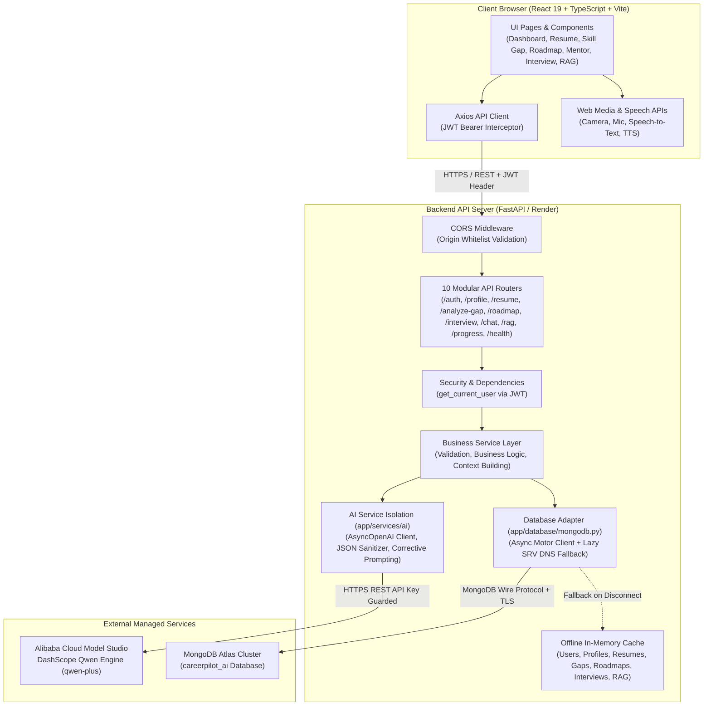
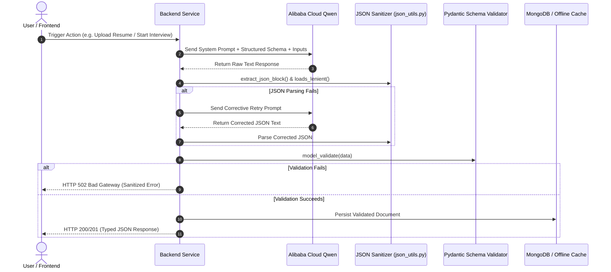
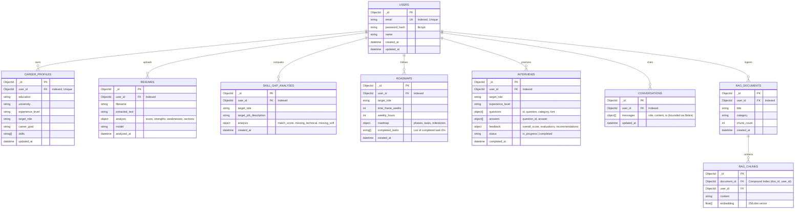

# CareerPilot AI

> **Your Personal AI Career Mentor, Resume Strategist & Interview Coach**
> Built for the **Alibaba Cloud AI Hackathon Pakistan 2026** · Theme: *AI for Pakistan's Future* · Build Window: August 29 – September 4, 2026

[](backend/tests/)
[](frontend/)
[](backend/)
[-orange?style=flat-square)](https://www.alibabacloud.com/en/solutions/model-studio)
[](backend/app/database/)

---

## Table of Contents

1. [Project Overview](#1-project-overview)
2. [Problem Statement and Project Goals](#2-problem-statement-and-project-goals)
3. [Key Features and Implementation Status](#3-key-features-and-implementation-status)
4. [Technology Stack](#4-technology-stack)
5. [System Architecture and Component Interactions](#5-system-architecture-and-component-interactions)
6. [Complete Project Directory Structure](#6-complete-project-directory-structure)
7. [Application Workflows](#7-application-workflows)
8. [API Documentation](#8-api-documentation)
9. [Database Design and Models](#9-database-design-and-models)
10. [AI, LLM & RAG Implementation](#10-aillm--rag-implementation)
11. [Authentication and Security](#11-authentication-and-security)
12. [Environment Variables](#12-environment-variables)
13. [Installation and Local Setup](#13-installation-and-local-setup)
14. [Running the Application](#14-running-the-application)
15. [Testing and Validation](#15-testing-and-validation)
16. [Deployment Instructions](#16-deployment-instructions)
17. [Known Issues and Limitations](#17-known-issues-and-limitations)
18. [Pending Tasks and Future Improvements](#18-pending-tasks-and-future-improvements)
19. [Important Technical Decisions and Their Rationale](#19-important-technical-decisions-and-their-rationale)
20. [Context for AI Assistants (AI Handoff Guide)](#20-context-for-ai-assistants)

---

## 1. Project Overview

**CareerPilot AI** is a production-grade, AI-driven career-readiness and technical interview preparation platform designed specifically for university students, fresh graduates, and junior engineers transitioning into the tech workforce.

Unlike fragmented single-purpose tools (isolated resume scorers or generic ChatGPT prompts), CareerPilot AI links six specialized intelligence modules into a **continuous, state-aware career guidance pipeline**:

```
Registration & Auth ➔ Career Profile ➔ PDF Resume Analysis ➔ Target Role Skill Gap ➔ Phased Learning Roadmap ➔ Multi-Turn Career Mentor ➔ Interactive Mock Interview ➔ Aggregated Progress Dashboard
```

Every user action feeds contextual intelligence downstream:
- Resume analysis automatically extracts skills, educational background, and experience.
- Skill Gap analysis compares extracted profile assets against user-defined target job descriptions.
- The Roadmap Generator ingests identified gaps and produces concrete, time-boxed milestones with task checkboxes.
- The AI Career Mentor answers conversational queries strictly grounded in the user's uploaded credentials.
- The Mock Interview module generates role-tailored technical and behavioral questions, simulates real interviews with in-browser camera and microphone feedback, and outputs scored evaluations using the industry-standard STAR methodology.
- The Grounded RAG Advisor enables vector retrieval across custom job specifications and syllabus guides.
- The Progress Dashboard unifies readiness metrics into a single real-time cockpit.

---

## 2. Problem Statement and Project Goals

### The Problem
Entering the technical job market presents steep hurdles for students and early-career developers:
1. **Opaque Resume Quality:** Candidates submit resumes without knowing if they meet Applicant Tracking System (ATS) baselines or entry-level industry thresholds.
2. **Ambiguous Skill Gaps:** Job descriptions demand laundry lists of competencies; students struggle to isolate which missing skills are essential versus secondary.
3. **Unstructured Upskilling:** Without guided curricula, learners waste weeks on disorganized tutorials instead of building portfolio-grade deliverables.
4. **Interview Anxiety & Lack of Practice:** Mock interview coaching is expensive or inaccessible, leaving candidates unprepared for real-time technical scrutiny and behavioral STAR framing.
5. **Generic, Ungrounded Advice:** Off-the-shelf AI chatbots hallucinate qualifications, give generic platitudes, or forget candidate constraints across sessions.

### Project Goals
- **Unified Pipeline:** Eliminate context fragmentation by orchestrating an integrated journey from resume intake to mock interview.
- **Strict Grounding & Zero Hallucination:** Build rigorous AI guardrails where LLM outputs are validated against strict Pydantic schemas and grounded in verified user data.
- **Enterprise-Grade Architecture:** Deliver a clean, typed codebase with a Python/FastAPI backend, React 19 frontend, robust CORS isolation, and offline resiliency.
- **Local Hackathon Reliability:** Ensure all modules function seamlessly even under unreliable internet conditions via an automatic in-memory fallback cache.

---

## 3. Key Features and Implementation Status

| # | Feature / Module | Route Prefix / Page | Implementation Status | Technical Details |
|---|------------------|---------------------|-----------------------|-------------------|
| 1 | **Authentication & Sessions** | `/api/auth` / `/login`, `/register` | **Implemented** (100%) | Direct `bcrypt` password hashing, JWT bearer tokens (HS256, 24h default expiry), secure token validation dependency. |
| 2 | **Career Profile** | `/api/profile` / `/profile` | **Implemented** (100%) | Single-profile-per-user lifecycle (`GET`, `POST`, `PUT`), educational background, target role, baseline skills, experience level. |
| 3 | **AI Resume Analyzer** | `/api/resume` / `/resume` | **Implemented** (100%) | PDF magic bytes & size validation, text extraction via PyMuPDF (`fitz`), structured Qwen analysis (score 0–100, strengths, weaknesses, missing info, extracted sections). |
| 4 | **Skill Gap Analysis** | `/api/analyze-gap` / `/skill-gap` | **Implemented** (100%) | Pre-fills from profile & resume, compares against target job description, returns match score (0–100), missing technical/soft skills, competency breakdown. |
| 5 | **Personalized Roadmap** | `/api/roadmap` / `/roadmap` | **Implemented** (100%) | Generates time-boxed phased plans (weeks & weekly hours budget), concrete milestones, resource links, persistent task completion checkboxes. |
| 6 | **AI Career Mentor** | `/api/chat` / `/mentor` | **Implemented** (100%) | Multi-turn conversational mentor grounded in user profile + latest resume analysis; bounded history (16 turns / 24k chars); anti-leak guardrails. |
| 7 | **AI Mock Interview** | `/api/interview` / `/interview` | **Implemented** (100%) | Technical, behavioral & situational question generation; in-browser video/mic stream preview; Web Speech API speech-to-text; TTS read-aloud; STAR rubric evaluation & scorecards. |
| 8 | **RAG Knowledge Base** | `/api/rag` / `/rag` | **Implemented** (100%) | Semantic text chunking (300 words, 50 overlap), 256-dim token-frequency vector embeddings, cosine similarity search, grounded Qwen chat with source citations. |
| 9 | **Progress Dashboard** | `/api/progress` / `/` | **Implemented** (100%) | Real-time aggregation of profile completeness (40% weight) + resume readiness score (60% weight), roadmap task progress, interview performance, dynamic next steps. |
| 10 | **Offline Mode Fallback** | Backend Database Layer | **Implemented** (100%) | Automatic transparent in-memory cache across users, profiles, resumes, skill gaps, roadmaps, interviews, and RAG chunks when MongoDB is disconnected. |
| 11 | **GitHub Profile Scraper** | — | *Planned (Post-MVP)* | Automatic extraction of repositories, tech stacks, and commit activity. |
| 12 | **LinkedIn Optimizer** | — | *Planned (Post-MVP)* | Headline, summary, and keyword recommendations for LinkedIn profiles. |
| 13 | **Multi-Language Urdu Support**| — | *Planned (Post-MVP)* | Localization and multilingual resume parsing for regional candidates. |

---

## 4. Technology Stack

### Frontend Architecture
- **Framework:** React 19 (`19.2.8`) with TypeScript (`~6.0.2`, strict mode)
- **Build Tool:** Vite 8 (`8.2.0`)
- **Routing:** React Router 7 (`7.18.2`)
- **Styling:** Tailwind CSS 3 (`3.4.19`) with PostCSS & Autoprefixer
- **State Management & Context:** React Context (`AuthContext` with automatic localStorage token hydration)
- **HTTP Client:** Axios (`1.19.0`) with request/response interceptors and standardized API error categorization (`describeApiError`)
- **Icons & Animation:** Lucide React (`1.40.0`), Framer Motion (`13.1.1`)
- **Browser APIs:** Web Speech API (`webkitSpeechRecognition` / `SpeechRecognition`), SpeechSynthesis (`window.speechSynthesis`), MediaDevices (`navigator.mediaDevices.getUserMedia`)
- **Code Quality:** Oxlint (`1.75.0`), TypeScript compiler (`tsc -b`)

### Backend Architecture
- **Framework:** Python 3.13+, FastAPI (`0.141.1`), Starlette (`1.6.0`)
- **ASGI Server:** Uvicorn (`0.52.4`) with Standard worker implementation
- **Data Validation:** Pydantic v2 (`2.13.4`) and `pydantic-core` (`2.46.4`)
- **Database Driver:** Motor (`3.7.1`) async MongoDB driver over PyMongo (`4.17.0`)
- **Authentication & Cryptography:** `bcrypt` (`5.0.0`) for salted password hashing, `python-jose` (`3.5.0`) with HS256 algorithm for JWT creation and decoding
- **Document Processing:** PyMuPDF (`1.28.2`) for high-fidelity PDF text extraction
- **File Uploads:** `python-multipart` (`0.0.32`)
- **DNS Resolution:** `dnspython` (`2.8.0`) with automated public DNS fallback (8.8.8.8, 1.1.1.1) for MongoDB Atlas SRV resolution
- **Environment Management:** `python-dotenv` (`1.2.3`) configured with absolute path loading
- **Testing:** `pytest` (`8.4.1`), `pytest-asyncio` (`1.1.0`), HTTPX (`0.28.1`)

### AI & LLM Engine
- **Provider:** Alibaba Cloud Model Studio (DashScope)
- **API Standard:** OpenAI-compatible endpoint (`AsyncOpenAI` client via `openai 3.6.0`)
- **Target Model:** `qwen-plus` (or `qwen3.7-plus`), configured via `ALIBABA_CLOUD_MODEL`
- **Output Control:** Thinking mode explicitly disabled (`enable_thinking: false`) for structured JSON payloads to ensure predictable parseability.

### Cloud & Deployment
- **Frontend Hosting:** Vercel (SPA routing handled via `vercel.json`)
- **Backend Hosting:** Render Web Service (Python runtime, configured via `render.yaml`)
- **Managed Database:** MongoDB Atlas (M0 Free Tier or dedicated cluster)

---

## 5. System Architecture and Component Interactions

CareerPilot AI enforces strict layer separation: the frontend never contacts the LLM provider directly, and client-supplied user identifiers are never trusted for authorization.

### High-Level Architectural Diagram



### The 4-Stage AI Output Validation Pipeline

To guarantee that invalid model responses never crash the application or pollute the database, all AI operations pass through four consecutive validation layers:



---

## 6. Complete Project Directory Structure

```
CareerPilot-AI/
├── .agents/                        # IDE Agent skills, rules, and configurations
│   └── skills/
│       └── ui-ux-pro-max/          # Design system & responsive UI rules
├── .gitignore                      # Git exclusion rules (safeguards .env, pycache, dist)
├── CHANGELOG.md                    # Detailed chronological build log (Day 1 – Day 6)
├── README.md                       # Master technical documentation & AI handoff specification
├── render.yaml                     # Render Infrastructure-as-Code deployment blueprint
│
├── backend/                        # FastAPI Application Root
│   ├── .env                        # Local backend environment variables (git-ignored)
│   ├── .env.example                # Canonical template for backend environment variables
│   ├── pyproject.toml              # Tooling & pytest configuration
│   ├── requirements.txt            # Locked Python dependencies
│   ├── app/                        # Application source code
│   │   ├── __init__.py
│   │   ├── config.py               # Settings loader (dotenv, CORS origin parsing, constants)
│   │   ├── main.py                 # FastAPI initialization, CORS, lifespan, global error handlers
│   │   ├── database/
│   │   │   ├── __init__.py
│   │   │   └── mongodb.py          # Motor client lifecycle, connection pooling, auto-indexing, DNS fallback
│   │   ├── models/                 # Model package namespace (Pydantic models in schemas/)
│   │   │   └── __init__.py
│   │   ├── routes/                 # 10 Thin FastAPI route controllers
│   │   │   ├── __init__.py
│   │   │   ├── ai.py               # AI health check & test route (/api/ai/test)
│   │   │   ├── auth.py             # User registration, login, and /me (/api/auth)
│   │   │   ├── chat.py             # Career Mentor multi-turn chat (/api/chat)
│   │   │   ├── interview.py        # Mock interview generation, submit, review (/api/interview)
│   │   │   ├── profile.py          # Career profile CRUD (/api/profile)
│   │   │   ├── progress.py         # Aggregated progress dashboard (/api/progress)
│   │   │   ├── rag.py              # Knowledge base document upload, query, chat (/api/rag)
│   │   │   ├── resume.py           # PDF resume upload & analysis (/api/resume)
│   │   │   ├── roadmap.py          # Learning roadmap generation & task toggling (/api/roadmap)
│   │   │   └── skill_gap.py        # Gap analysis comparing resume vs target role (/api)
│   │   ├── schemas/                # Pydantic request, response, and database schemas
│   │   │   ├── __init__.py
│   │   │   ├── ai.py               # AITestRequest, AITestResponse
│   │   │   ├── auth.py             # RegisterRequest, LoginRequest, UserResponse, TokenResponse
│   │   │   ├── chat.py             # MentorChatRequest, MentorChatResponse, ChatMessage
│   │   │   ├── interview.py        # InterviewStartRequest, InterviewSubmitRequest, Feedback models
│   │   │   ├── profile.py          # ProfileUpsertRequest, ProfileResponse
│   │   │   ├── progress.py         # DashboardResponse, ModuleProgress, NextStep
│   │   │   ├── rag.py              # DocumentIngestRequest, ChunkSource, RAGChat models
│   │   │   ├── resume.py           # ResumeAnalysisResponse, ResumeSections, Education/Project models
│   │   │   ├── roadmap.py          # RoadmapRequest, RoadmapContent, Phase/Task models, TaskToggle
│   │   │   └── skill_gap.py        # SkillGapRequest, SkillGapResponse, RequiredProficiency
│   │   └── services/               # Core business logic layer
│   │       ├── __init__.py
│   │       ├── auth_service.py     # User registration, authentication, offline user cache
│   │       ├── chat_service.py     # Conversation persistence, turn truncation, history building
│   │       ├── dependencies.py     # get_current_user FastAPI dependency
│   │       ├── interview_service.py# Mock interview question generation, STAR evaluation, offline cache
│   │       ├── profile_service.py  # Profile retrieval, upsert logic, offline profile cache
│   │       ├── progress_service.py # Cross-module progress calculation & metric weighting
│   │       ├── rag_service.py      # Semantic chunking, 256-dim vector embedding, cosine retrieval
│   │       ├── resume_service.py   # PDF magic byte checking, PyMuPDF extraction, offline resume cache
│   │       ├── roadmap_service.py  # Learning roadmap orchestration, task toggle logic, offline cache
│   │       ├── security.py         # Direct bcrypt hashing & python-jose JWT encoding/decoding
│   │       ├── skill_gap_service.py# Gap comparison logic, Qwen schema validation, offline cache
│   │       └── ai/                 # Isolated LLM integration layer
│   │           ├── __init__.py
│   │           ├── career_mentor.py# Career mentor prompt construction, grounding, anti-leak checks
│   │           ├── json_utils.py   # extract_json_block, loads_lenient (handles unescaped chars)
│   │           ├── qwen_service.py # AsyncOpenAI client, timeout handling, sanitized error mapping
│   │           └── resume_analyzer.py# Resume system prompt, character truncation, analysis parser
│   └── tests/                      # Pytest Suite (171 tests)
│       ├── __init__.py
│       ├── test_chat.py            # Chat service & route tests
│       ├── test_cors.py            # CORS middleware & origin normalization tests
│       ├── test_interview.py       # Interview generation & evaluation tests
│       ├── test_progress.py        # Dashboard aggregation & formula tests
│       ├── test_qwen_service.py    # LLM service & mock tests
│       ├── test_rag.py             # Chunking, vector embeddings & RAG tests
│       ├── test_resume.py          # PDF extraction & resume analyzer tests
│       ├── test_roadmap.py         # Roadmap generation & task toggle tests
│       └── test_skill_gap.py       # Skill gap analysis tests
│
├── frontend/                       # React 19 Frontend Application
│   ├── .env.example                # Canonical template for frontend environment variables
│   ├── package.json                # Frontend dependencies and scripts
│   ├── postcss.config.js           # PostCSS configuration
│   ├── tailwind.config.js          # Tailwind CSS theme and styling configuration
│   ├── tsconfig.json               # TypeScript project references
│   ├── tsconfig.app.json           # Application TypeScript strict configuration
│   ├── tsconfig.node.json          # Vite node tooling TypeScript configuration
│   ├── vercel.json                 # Vercel SPA rewrite configuration
│   ├── vite.config.ts              # Vite 8 build & plugin settings
│   └── src/                        # Frontend source code
│       ├── App.tsx                 # Client-side router configuration & route protection
│       ├── index.css               # Global Tailwind CSS imports & custom utility classes
│       ├── main.tsx                # React DOM root entry point
│       ├── components/             # Reusable UI widgets
│       │   ├── ProtectedRoute.tsx  # JWT authentication route guard
│       │   └── chat/
│       │       └── MessageContent.tsx# Markdown message renderer with code highlighting
│       ├── context/
│       │   └── AuthContext.tsx     # Global auth state, token persistence, user session
│       ├── layouts/
│       │   └── AppLayout.tsx       # Main responsive app shell with topbar & mobile navigation
│       ├── pages/                  # 10 Page Views
│       │   ├── CareerMentorPage.tsx# Conversational AI mentor with markdown & suggestions
│       │   ├── LoginPage.tsx       # Email/password authentication form
│       │   ├── MockInterviewPage.tsx# Interview lobby, video/audio preview, speech recognition, scorecard
│       │   ├── ProfilePage.tsx     # Student career profile creation and update form
│       │   ├── ProgressDashboardPage.tsx# Aggregated readiness dashboard with prioritized next actions
│       │   ├── RagKnowledgePage.tsx# Document upload, vector search, and grounded RAG chat
│       │   ├── RegisterPage.tsx    # User registration form
│       │   ├── ResumeAnalyzerPage.tsx# Drag-and-drop PDF upload, ATS score gauge, breakdown cards
│       │   ├── RoadmapPage.tsx     # Phased learning roadmap with progress bar & task toggle checkboxes
│       │   └── SkillGapPage.tsx    # Resume-to-job comparison with domain competency framework
│       ├── services/               # API Client Service Layer
│       │   ├── ai.ts               # AI connectivity test call
│       │   ├── apiClient.ts        # Axios instance, Bearer token interceptor, describeApiError
│       │   ├── auth.ts             # Auth endpoints (/login, /register, /me)
│       │   ├── chat.ts             # Mentor endpoints (/message, /history)
│       │   ├── interview.ts        # Interview endpoints (/start, /submit, /latest, /:id)
│       │   ├── profile.ts          # Profile endpoints (/profile)
│       │   ├── progress.ts         # Progress endpoint (/progress)
│       │   ├── rag.ts              # RAG endpoints (/documents, /query, /chat)
│       │   ├── resume.ts           # Resume endpoints (/analyze, /latest)
│       │   ├── roadmap.ts          # Roadmap endpoints (/generate, /latest, /toggle)
│       │   └── skillGap.ts         # Skill gap endpoints (/analyze-gap, /latest)
│       └── types/
│           └── index.ts            # Complete TypeScript interface definitions matching backend schemas
│
└── docs/                           # Architectural Specifications & Hackathon Artifacts
    ├── AGENT_SKILLS.md             # Contracts for AI agent personas
    ├── AGENTS.md                   # Agent system overview
    ├── AI_ARCHITECTURE.md          # LLM trust model & bounded context rules
    ├── API_SPEC.md                 # Original API design contract
    ├── ARCHITECTURE.md             # Architecture overview & rationale
    ├── ARCHITECTURE_DIAGRAM.md     # Architecture diagram notes
    ├── DATABASE_SCHEMA.md          # Database schema reference
    ├── DEMO_FLOW.md                # Hackathon presentation walkthrough script
    ├── DEVELOPMENT_PLAN.md         # 7-day development plan
    ├── GIT_WORKFLOW.md             # Branching strategy & conventions
    ├── MCP_PLAN.md                 # Model Context Protocol roadmap
    ├── MEMORY_PLAN.md              # Long-term memory strategy
    ├── MVP_SCOPE.md                # Strict MVP scope boundaries
    ├── PROJECT_CONTEXT.md          # AI session operational context
    └── PROJECT_SPEC.md             # Initial project specifications
```

---

## 7. Application Workflows

### 1. User Onboarding & Profile Initialization
```
User visits /register ➔ Creates Account (Bcrypt Hashed) ➔ Automatic Login (Receives JWT) ➔ Redirects to /profile ➔ Enters Education, Target Role, Current Skills ➔ Stored in career_profiles
```

### 2. Resume Upload & ATS Readiness Scoring
```
User navigates to /resume ➔ Uploads PDF File (≤ 5MB)
  ├─ Backend validates PDF magic bytes (%PDF) & size
  ├─ PyMuPDF extracts text layer
  ├─ Qwen analyzes ATS compatibility, strengths, weaknesses, sections
  ├─ Pydantic validates structured schema
  └─ UI renders interactive score gauge (0-100), sections, and improvement recommendations
```

### 3. Contextual Skill Gap Analysis
```
User opens /skill-gap ➔ Page auto-fills current skills from latest resume & target role from profile
  ├─ User pastes target job description
  ├─ Backend Qwen compares skills vs requirements
  ├─ Identifies missing technical skills, missing soft skills, domain competencies
  └─ Returns Match Score % and displays direct "Generate Roadmap" action bridge
```

### 4. Phased Learning Roadmap & Task Tracking
```
User enters /roadmap ➔ Clicks "Import from Gaps" (Pulls missing competencies automatically)
  ├─ Configures timeframe (weeks) and available weekly hours
  ├─ Qwen constructs 2–4 sequential phases with concrete tasks, estimated hours, resources, milestones
  ├─ User toggles task checkboxes as they study
  └─ PUT /api/roadmap/{id}/tasks/{taskId}/toggle updates progress persistently in MongoDB
```

### 5. Multi-Turn Conversational Career Mentor
```
User navigates to /mentor ➔ Types question (e.g. "What project should I build for my portfolio?")
  ├─ Backend retrieves conversation history (up to 16 turns / 24,000 characters)
  ├─ Backend retrieves user profile and latest resume analysis
  ├─ Injects strict grounding prompt (no hallucinations, no leaking internal tags)
  ├─ Qwen generates tailored advice
  └─ Conversation turn atomically appended to MongoDB with $slice bounding
```

### 6. Interactive AI Mock Interview with Scoring
```
User opens /interview ➔ Imports target role and focus skills from Skill Gap
  ├─ Selects mode (Video, Voice, or Text) & question count (1–5)
  ├─ Browser requests camera/mic permissions with live preview
  ├─ Qwen generates tailored questions across technical, behavioral & situational categories
  ├─ Candidate answers via typing or Web Speech API voice dictation
  ├─ Question hints available with STAR framework prompts
  ├─ On submit, Qwen evaluates each answer: strengths, improvements, ideal benchmark answer, overall score
  └─ Detailed scorecard rendered with actionable preparation guidance
```

### 7. Grounded RAG Knowledge Base
```
User enters /rag ➔ Uploads target company rubric, course syllabus, or specialized job spec
  ├─ Text chunked into 300-word blocks with 50-word overlap
  ├─ 256-dimensional normalized frequency vector embeddings computed
  ├─ User queries knowledge base or initiates grounded chat
  ├─ Cosine similarity vector search retrieves top-k chunks
  └─ Qwen answers questions with explicit context citation cards
```

---

## 8. API Documentation

Base URL: `http://localhost:8000` (Local) / Configured Render Host (Production).  
All protected endpoints require an `Authorization: Bearer <JWT>` header.

### Authentication Endpoints (`/api/auth`)

| Method | Endpoint | Auth | Request Body | Success Response | Error Codes |
|---|---|---|---|---|---|
| `POST` | `/api/auth/register` | No | `{ name, email, password }` | `201 Created` (`UserResponse`) | `400`, `409 Conflict`, `422` |
| `POST` | `/api/auth/login` | No | `{ email, password }` | `200 OK` (`TokenResponse`) | `401 Unauthorized`, `422` |
| `GET` | `/api/auth/me` | Bearer | None | `200 OK` (`UserResponse`) | `401 Unauthorized` |

### Career Profile Endpoints (`/api/profile`)

| Method | Endpoint | Auth | Request Body | Success Response | Error Codes |
|---|---|---|---|---|---|
| `GET` | `/api/profile` | Bearer | None | `200 OK` (`ProfileResponse`) | `401`, `404 Not Found` |
| `POST` | `/api/profile` | Bearer | `ProfileUpsertRequest` | `201 Created` (`ProfileResponse`) | `401`, `409 Conflict` |
| `PUT` | `/api/profile` | Bearer | `ProfileUpsertRequest` | `200 OK` (`ProfileResponse`) | `401`, `422` |

### Resume Analyzer Endpoints (`/api/resume`)

| Method | Endpoint | Auth | Request Body | Success Response | Error Codes |
|---|---|---|---|---|---|
| `POST` | `/api/resume/analyze` | Bearer | `multipart/form-data` (`file: PDF`) | `200 OK` (`ResumeAnalysisResponse`)| `400 Bad Request`, `502 Bad Gateway`, `503` |
| `GET` | `/api/resume/latest` | Bearer | None | `200 OK` (`ResumeAnalysisResponse`)| `401`, `404 Not Found` |

### Skill Gap Analysis Endpoints (`/api`)

| Method | Endpoint | Auth | Request Body | Success Response | Error Codes |
|---|---|---|---|---|---|
| `POST` | `/api/analyze-gap` | Bearer | `SkillGapRequest` | `200 OK` (`SkillGapResponse`) | `401`, `422`, `502 Bad Gateway` |
| `GET` | `/api/analyze-gap/latest` | Bearer | None | `200 OK` (`SkillGapResponse`) | `401`, `404 Not Found` |

### Roadmap Generator Endpoints (`/api/roadmap`)

| Method | Endpoint | Auth | Request Body | Success Response | Error Codes |
|---|---|---|---|---|---|
| `POST` | `/api/roadmap/generate` | Bearer | `RoadmapRequest` | `200 OK` (`RoadmapResponse`) | `401`, `422`, `502 Bad Gateway` |
| `GET` | `/api/roadmap/latest` | Bearer | None | `200 OK` (`RoadmapResponse`) | `401`, `404 Not Found` |
| `PUT` | `/api/roadmap/{id}/tasks/{taskId}/toggle` | Bearer | `{ completed: boolean }` | `200 OK` (`RoadmapResponse`) | `401`, `404 Not Found` |

### AI Career Mentor Chat Endpoints (`/api/chat`)

| Method | Endpoint | Auth | Request Body | Success Response | Error Codes |
|---|---|---|---|---|---|
| `POST` | `/api/chat/message` | Bearer | `{ message: string, conversation_id?: string }` | `200 OK` (`MentorChatResponse`) | `400`, `401`, `404`, `502` |
| `GET` | `/api/chat/history` | Bearer | Query: `conversation_id` (optional) | `200 OK` (`MentorHistoryResponse`) | `400`, `401`, `404` |

### Mock Interview Endpoints (`/api/interview`)

| Method | Endpoint | Auth | Request Body | Success Response | Error Codes |
|---|---|---|---|---|---|
| `POST` | `/api/interview/start` | Bearer | `InterviewStartRequest` | `200 OK` (`InterviewResponse`) | `401`, `422`, `502 Bad Gateway` |
| `POST` | `/api/interview/{id}/submit` | Bearer | `InterviewSubmitRequest` | `200 OK` (`InterviewResponse`) | `401`, `404`, `502 Bad Gateway` |
| `GET` | `/api/interview/latest` | Bearer | None | `200 OK` (`InterviewResponse`) | `401`, `404 Not Found` |
| `GET` | `/api/interview/{id}` | Bearer | None | `200 OK` (`InterviewResponse`) | `401`, `404 Not Found` |

### RAG Knowledge Base Endpoints (`/api/rag`)

| Method | Endpoint | Auth | Request Body | Success Response | Error Codes |
|---|---|---|---|---|---|
| `POST` | `/api/rag/documents/upload` | Bearer | `DocumentIngestRequest` | `201 Created` (`DocumentUploadResponse`) | `401`, `500` |
| `GET` | `/api/rag/documents` | Bearer | None | `200 OK` (`list[DocumentInfo]`) | `401` |
| `DELETE`| `/api/rag/documents/{id}` | Bearer | None | `204 No Content` | `401`, `404 Not Found` |
| `POST` | `/api/rag/query` | Bearer | `RAGQueryRequest` | `200 OK` (`RetrievalResult`) | `401`, `422` |
| `POST` | `/api/rag/chat` | Bearer | `RAGChatRequest` | `200 OK` (`RAGChatResponse`) | `401`, `500` |

### Progress Dashboard & System Endpoints

| Method | Endpoint | Auth | Description | Success Response |
|---|---|---|---|---|
| `GET` | `/api/progress` | Bearer | Computes aggregated progress across all modules | `200 OK` (`DashboardResponse`) |
| `GET` | `/api/health` | No | Self-healing ping verifying MongoDB connection | `200 OK` (`{"status": "ok", "database": "connected"}`) |
| `POST` | `/api/ai/test` | Bearer | Smoke test end-to-end Qwen connectivity | `200 OK` (`AITestResponse`) |

---

## 9. Database Design and Models

CareerPilot AI uses **MongoDB** via the async Motor driver. Every operational document is strictly isolated by `user_id: ObjectId`.



> **Note on Progress:** There is intentionally **no static `progress` collection**. The `/api/progress` endpoint dynamically aggregates data from `career_profiles`, `resumes`, `roadmaps`, and `interviews` on demand, guaranteeing zero stale metric divergence.

### Automatic Indexes (Created Idempotently on Startup)
```python
await db.users.create_index("email", unique=True)
await db.career_profiles.create_index("user_id", unique=True)
await db.resumes.create_index("user_id")
await db.skill_gap_analyses.create_index("user_id")
await db.conversations.create_index("user_id")
await db.roadmaps.create_index("user_id")
await db.interviews.create_index("user_id")
await db.rag_documents.create_index("user_id")
await db.rag_chunks.create_index([("document_id", 1), ("user_id", 1)])
```

---

## 10. AI/LLM & RAG Implementation

### LLM Integration Architecture
All LLM interactions pass through `app/services/ai/qwen_service.py` via Alibaba Cloud Model Studio DashScope:
- **Client Configuration:** Uses `openai.AsyncOpenAI` pointed to `https://dashscope.aliyuncs.com/compatible-mode/v1`.
- **SDK Retries Disabled:** `max_retries=0` is set on the client so that application-level corrective retries retain full deterministic control.
- **Thinking Mode Guard:** `extra_body={"enable_thinking": False}` is sent for all structured-output tasks (resume, gap, roadmap, interview) to prevent Qwen from emitting `<think>...</think>` tags that disrupt JSON parsers.

### Prompts & Temperature Profile
| Task | Temperature | Timeout | System Prompt Objective |
|---|---|---|---|
| **Resume Analysis** | `0.2` | 120s | Strict ATS scoring, zero-hallucination extraction, empty array defaults for missing sections. |
| **Skill Gap Analysis** | `0.2` | 120s | Objective gap isolation, match score % calculation, domain proficiency breakdown. |
| **Roadmap Generation** | `0.2` | 120s | Time-boxed phase curriculum, weekly budget compliance, deliverable milestones. |
| **Interview Generation**| `0.3` | 120s | Realistic technical/behavioral question distribution tailored to experience level with STAR hints. |
| **Interview Evaluation**| `0.3` | 120s | STAR rubric assessment, 0–100 question scoring, benchmark ideal answers. |
| **Career Mentor Chat** | `0.7` | 60s | Conversational, encouraging, grounded in user context block; anti-leak boundary protection. |
| **RAG Grounded Chat** | `0.3` | 60s | Strict context citation from retrieved document chunks; explicitly flags ungrounded general advice. |

### RAG Pipeline Mechanics
1. **Semantic Text Chunking:** `chunk_text()` splits raw documents into 300-word segments with a 50-word sliding overlap, preserving contextual continuity across chunk boundaries.
2. **Dense Vector Embeddings:** `compute_text_vector()` generates a 256-dimensional deterministic frequency vector using token hashing and L2 normalization:
   $$\vec{v}_{\text{norm}} = \frac{\vec{v}}{\|\vec{v}\|_2}$$
3. **Similarity Search:** `cosine_similarity()` ranks candidate chunks against the user's query vector:
   $$\text{sim}(\vec{q}, \vec{d}) = \vec{q} \cdot \vec{d} = \sum_{i=1}^{256} q_i d_i$$
4. **Context Grounding:** The top-$k$ retrieved chunks are formatted into the system prompt's `=== RETRIEVED CONTEXT SOURCES ===` block, and citations are returned to the client.

---

## 11. Authentication and Security

### Threat Model & Defensive Measures
1. **Password Hashing:** Passwords are never stored in plaintext. They are salted and hashed using direct `bcrypt` (`bcrypt.hashpw` with `gensalt()`). `passlib` was intentionally eliminated due to known incompatibilities with `bcrypt >= 4.1`.
2. **Stateless JWT Authorization:** Tokens are signed with HMAC-SHA256 (`HS256`) using `JWT_SECRET`. Claims contain only `sub` (user ObjectId) and `exp` (timestamp).
3. **Zero-Trust User Scoping:** Identity is derived exclusively from the validated JWT via the `get_current_user` FastAPI dependency. Handlers never accept a `user_id` parameter from request bodies or URLs.
4. **Strict CORS Whitelist:** `FRONTEND_ORIGIN` is parsed with string normalization (stripping accidental quotes, brackets, and trailing slashes). Wildcards (`*`) are disallowed because the API uses authenticated Bearer headers.
5. **Information Leakage Prevention:**
   - Database connection failures log only sanitized error categories (e.g. `server_selection_timeout`, `authentication_failed`) — credentials and URIs are never printed.
   - Global exception handler catches unhandled exceptions, logs the traceback server-side, and returns a sanitized `{"detail": "Internal server error"}` with HTTP 500.
   - LLM prompts include explicit boundaries preventing the model from regurgitating system instructions or internal markers (`USER CONTEXT`).

---

## 12. Environment Variables

### Backend (`backend/.env`)

Copy `backend/.env.example` to `backend/.env`:

```ini
# MongoDB Atlas connection string (or local mongodb://localhost:27017)
MONGODB_URI=mongodb+srv://<user>:<password>@cluster.mongodb.net/?retryWrites=true&w=majority

# Database name (default: careerpilot_ai)
MONGODB_NAME=careerpilot_ai

# Secret key for signing JWTs (generate using: python -c "import secrets; print(secrets.token_urlsafe(48))")
JWT_SECRET=your_super_secret_jwt_key_here

# JWT lifetime in minutes (default: 1440 = 24 hours)
JWT_EXPIRES_MINUTES=1440

# Alibaba Cloud Model Studio (DashScope) API key for Qwen
ALIBABA_CLOUD_API_KEY=sk-your-dashscope-api-key

# OpenAI-compatible DashScope endpoint
ALIBABA_CLOUD_BASE_URL=https://dashscope.aliyuncs.com/compatible-mode/v1

# Qwen model name (default: qwen-plus; also supports qwen3.7-plus)
ALIBABA_CLOUD_MODEL=qwen-plus

# Qwen API request timeout in seconds (default: 60)
QWEN_TIMEOUT=60

# Disable Qwen3 thinking mode for structured outputs (default: false)
QWEN_ENABLE_THINKING=false

# Comma-separated list of allowed frontend origins for CORS
FRONTEND_ORIGIN=http://localhost:5173,http://localhost:5174,http://localhost:5175,https://your-app.vercel.app

# Maximum resume upload size in megabytes (default: 5)
RESUME_MAX_SIZE_MB=5
```

### Frontend (`frontend/.env`)

Copy `frontend/.env.example` to `frontend/.env`:

```ini
# Base URL of the FastAPI backend (no trailing slash)
VITE_API_BASE_URL=http://localhost:8000
```

---

## 13. Installation and Local Setup

### Prerequisites
- **Python 3.13+** with `pip` and `venv`
- **Node.js 18+** with `npm`
- **Alibaba Cloud Model Studio API Key** (required for AI capabilities)
- **MongoDB Atlas account or local MongoDB instance** (optional — offline mode functions without it)

### Step 1: Clone the Repository
```bash
git clone https://github.com/imzohaib-web/CareerPilot-AI.git
cd CareerPilot-AI
```

### Step 2: Backend Setup
```bash
cd backend

# Create Python virtual environment
python -m venv venv

# Activate virtual environment
# On Windows (PowerShell):
.\venv\Scripts\Activate.ps1
# On macOS / Linux:
source venv/bin/activate

# Install locked dependencies
pip install -r requirements.txt

# Configure environment variables
copy .env.example .env    # Windows
# cp .env.example .env    # macOS / Linux
# Open .env and fill in ALIBABA_CLOUD_API_KEY, JWT_SECRET, and MONGODB_URI
```

### Step 3: Frontend Setup
```bash
cd ../frontend

# Install dependencies
npm install

# Configure environment variables
copy .env.example .env    # Windows
# cp .env.example .env    # macOS / Linux
```

---

## 14. Running the Application

### Start the Backend Server
```bash
cd backend
# Windows:
.\venv\Scripts\python -m uvicorn app.main:app --reload --host 127.0.0.1 --port 8000
# macOS / Linux:
./venv/bin/python -m uvicorn app.main:app --reload --host 127.0.0.1 --port 8000
```
- API Base URL: `http://localhost:8000`
- Interactive OpenAPI / Swagger Docs: `http://localhost:8000/docs`
- Health Check: `http://localhost:8000/api/health`

### Start the Frontend Development Server
In a separate terminal:
```bash
cd frontend
npm run dev
```
- Web Application: `http://localhost:5173`

---

## 15. Testing and Validation

### Backend Test Suite (Pytest)
The backend includes 171 automated tests verifying route behavior, authentication, CORS headers, service edge cases, and mocked LLM parsing:

```bash
cd backend
.\venv\Scripts\python -m pytest tests/ -v
```

```
============================= test session starts =============================
platform win32 -- Python 3.13.x, pytest-8.4.1, pluggy-1.5.0
plugins: anyio-4.14.2, asyncio-1.1.0
collected 171 items

tests/test_chat.py ................................................      [ 28%]
tests/test_cors.py ...........                                           [ 34%]
tests/test_interview.py .................                                [ 44%]
tests/test_progress.py ....................................              [ 65%]
tests/test_qwen_service.py ........                                      [ 70%]
tests/test_rag.py .............                                          [ 77%]
tests/test_resume.py .........................                           [ 92%]
tests/test_roadmap.py .........                                          [ 97%]
tests/test_skill_gap.py .....                                            [100%]

============================= 171 passed in 12.01s ============================
```

### Frontend Type-Checking and Build Verification
```bash
cd frontend

# TypeScript strict compile check
npx tsc -b

# Oxlint linter check
npx oxlint

# Production bundle build
npm run build
```

---

## 16. Deployment Instructions

### 1. Backend Deployment — Render
1. Create a new **Web Service** on [Render](https://render.com).
2. Connect your GitHub repository (`CareerPilot-AI`).
3. Set the **Root Directory** to `backend`.
4. Configure build and start commands:
   - **Build Command:** `pip install -r requirements.txt`
   - **Start Command:** `uvicorn app.main:app --host 0.0.0.0 --port $PORT`
5. Under **Environment Variables**, configure:
   - `MONGODB_URI`: Your MongoDB Atlas connection string.
   - `MONGODB_NAME`: `careerpilot_ai`
   - `JWT_SECRET`: Random 48+ character secret string.
   - `ALIBABA_CLOUD_API_KEY`: Your DashScope API key.
   - `ALIBABA_CLOUD_BASE_URL`: `https://dashscope.aliyuncs.com/compatible-mode/v1`
   - `ALIBABA_CLOUD_MODEL`: `qwen-plus`
   - `FRONTEND_ORIGIN`: Your production Vercel frontend URL (e.g. `https://careerpilot-ai.vercel.app`).
   - `QWEN_TIMEOUT`: `60`
   - `RESUME_MAX_SIZE_MB`: `5`
6. Set the **Health Check Path** to `/api/health`.

> **Note:** A `render.yaml` blueprint is present in the repository root for automated infrastructure provisioning.

### 2. Frontend Deployment — Vercel
1. Import the repository into [Vercel](https://vercel.com).
2. Set the **Root Directory** to `frontend`.
3. Vercel automatically detects the Vite framework preset.
4. Add the environment variable:
   - `VITE_API_BASE_URL`: The production URL of your Render backend (no trailing slash).
5. Deploy. SPA client-side routing is handled by `frontend/vercel.json`:
   ```json
   {
     "rewrites": [{ "source": "/(.*)", "destination": "/index.html" }]
   }
   ```

### 3. Database Deployment — MongoDB Atlas
1. Deploy a free M0 cluster on [MongoDB Atlas](https://www.mongodb.com/atlas).
2. Under **Network Access**, whitelist your IP or allow access from anywhere (`0.0.0.0/0`) so Render workers can connect.
3. Under **Database Access**, create a user with `readWriteAnyDatabase` privileges.
4. Copy the connection string into the backend's `MONGODB_URI`. All necessary indexes are created automatically on application startup.

---

## 17. Known Issues and Limitations

1. **Scanned PDF Text Extraction:** `PyMuPDF` relies on selectable text streams. Image-only/scanned PDF resumes without embedded OCR text layers will be rejected with a user-friendly error asking for a text-based PDF.
2. **Deterministic Vector Dimension:** The RAG module uses a fixed 256-dimensional token-frequency hash vector. While lightweight and zero-dependency, it does not achieve the deep semantic nuance of dense neural embeddings (e.g. `text-embedding-v3`).
3. **In-Memory Cache Volatility:** When running in offline mode without MongoDB, data is cached in process memory (`_offline_*` dictionaries). Restarting or redeploying the backend resets this in-memory cache.
4. **React Compiler Linter Warnings:** `oxlint` reports 9 cosmetic `react(set-state-in-effect)` warnings on initial page mount `load*()` hooks. These are non-blocking and do not trigger infinite loops or runtime errors.
5. **Speech Recognition Browser Support:** Web Speech API (`webkitSpeechRecognition`) is supported natively in Chromium-based browsers (Chrome, Edge, Brave). In unsupported browsers, voice dictation falls back gracefully to standard keyboard input.

---

## 18. Pending Tasks and Future Improvements

- [ ] **Server-Side Audio Processing:** Integrate Whisper STT and Alibaba Cloud CosyVoice TTS for native, cross-browser voice conversations.
- [ ] **GitHub Activity Auditing:** Connect GitHub OAuth to analyze public repositories, commit patterns, and code samples to auto-verify stated resume skills.
- [ ] **LinkedIn Profile Optimization:** Add an AI generator for LinkedIn headlines, "About" sections, and keyword density tuning.
- [ ] **Model Context Protocol (MCP):** Implement MCP tool servers enabling CareerPilot AI to query live job search APIs and technical documentation.
- [ ] **Multi-Language Support:** Localize interface and analysis prompts for Urdu and regional languages.

---

## 19. Important Technical Decisions and Their Rationale

1. **Python + FastAPI Selected Over Node.js / Express:**
   - *Rationale:* PyMuPDF text extraction, future AI/ML data pipelines, and numerical vector operations are substantially cleaner and better supported in the Python ecosystem.
2. **Single Backend Architecture:**
   - *Rationale:* Eliminated microservice network overhead and deployment complexity. All 10 modules share a single FastAPI instance and database connection pool.
3. **Direct `bcrypt` Instead of `passlib`:**
   - *Rationale:* `passlib 1.7.4` has an unmaintained bug that crashes on `bcrypt >= 4.1` hashes (`ValueError: invalid salt`). Using `bcrypt` directly guarantees compatibility and long-term maintainability.
4. **Alibaba Cloud Model Studio via `openai` SDK:**
   - *Rationale:* DashScope's OpenAI-compatible mode allows using standard, highly optimized async clients (`AsyncOpenAI`) while maintaining complete provider isolation in `app/services/ai`.
5. **Dynamic Metric Aggregation for Progress Dashboard:**
   - *Rationale:* Rather than maintaining a separate `progress` collection with potential sync errors, `/api/progress` computes completion metrics dynamically across profile, resume, roadmap, and interview documents.
6. **Graceful Offline Mode:**
   - *Rationale:* In hackathon presentation environments with unpredictable network connectivity, the app transparently falls back to in-memory caching rather than failing with connection timeouts.

---

## 20. Context for AI Assistants

> **Notice for AI Assistants (ChatGPT, Claude, Gemini, Cursor, Copilot, etc.):**  
> Read this section carefully before proposing code modifications or analyzing bugs. This section contains the complete technical invariants, design rules, and mental model for CareerPilot AI.

### System Essence & Invariants
- **What CareerPilot AI is:** An integrated career readiness platform connecting profile intake, resume parsing, skill gap analysis, personalized roadmaps, multi-turn career mentoring, mock interviews, and RAG search.
- **Backend Single Source of Truth:** The backend is Python + FastAPI located in `backend/app`. There is NO Node/Express backend. Never suggest Express routes.
- **AI Access Boundary:** All calls to Qwen MUST go through `app/services/ai`. Never import `openai` or make LLM calls in routes or frontend components.
- **Security Invariant:** User identity is ALWAYS extracted from the validated JWT bearer token via `current_user: dict = Depends(get_current_user)`. Never accept `user_id` as a client-supplied path parameter or body property.
- **Frontend Architecture:** React 19 + TypeScript in `frontend/src`. Uses React Router 7 and centralized Axios in `frontend/src/services/apiClient.ts`.
- **Database Architecture:** Async Motor MongoDB driver in `backend/app/database/mongodb.py`. All collections store documents with `user_id: ObjectId`.

### Module Mapping & File Responsibilities
| Feature | Route File (`app/routes/`) | Service File (`app/services/`) | Schema File (`app/schemas/`) | Frontend Page (`frontend/src/pages/`) |
|---|---|---|---|---|
| **Auth** | `auth.py` | `auth_service.py`, `security.py` | `auth.py` | `LoginPage.tsx`, `RegisterPage.tsx` |
| **Profile** | `profile.py` | `profile_service.py` | `profile.py` | `ProfilePage.tsx` |
| **Resume** | `resume.py` | `resume_service.py`, `ai/resume_analyzer.py` | `resume.py` | `ResumeAnalyzerPage.tsx` |
| **Skill Gap** | `skill_gap.py` | `skill_gap_service.py` | `skill_gap.py` | `SkillGapPage.tsx` |
| **Roadmap** | `roadmap.py` | `roadmap_service.py` | `roadmap.py` | `RoadmapPage.tsx` |
| **Mentor** | `chat.py` | `chat_service.py`, `ai/career_mentor.py` | `chat.py` | `CareerMentorPage.tsx` |
| **Interview** | `interview.py` | `interview_service.py` | `interview.py` | `MockInterviewPage.tsx` |
| **RAG** | `rag.py` | `rag_service.py` | `rag.py` | `RagKnowledgePage.tsx` |
| **Progress** | `progress.py` | `progress_service.py` | `progress.py` | `ProgressDashboardPage.tsx` |

### Coding Standards & Modifying the Codebase
1. **Always Verify First:** Before proposing changes, inspect the actual files using code view tools. Do not invent endpoints or fields.
2. **Preserve Pydantic Defaults:** Schemas in `app/schemas` use lenient field validators and default factories (`Field(default_factory=list)`) to ensure partial LLM outputs do not trigger runtime 500 crashes.
3. **Preserve Thinking Mode Disabling:** When calling Qwen for structured JSON, ensure `enable_thinking: false` is maintained. Otherwise, `<think>` tags will break `json_utils.loads_lenient()`.
4. **Preserve Offline Fallbacks:** When modifying service methods that access MongoDB, maintain the `try ... except ...` fallbacks to `_offline_*` dictionaries to preserve offline demo resilience.
5. **Run the Verification Suite:**
   - Backend tests: `pytest tests/ -v` (all 171 tests must pass).
   - Frontend validation: `npx tsc -b` and `npx oxlint` must run without errors.

---

## License

This project was built for the **Alibaba Cloud AI Hackathon Pakistan 2026**. All rights reserved by the development team. See [LICENSE](LICENSE) for terms.
